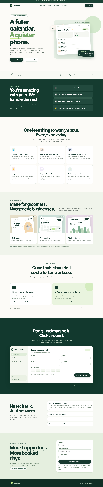
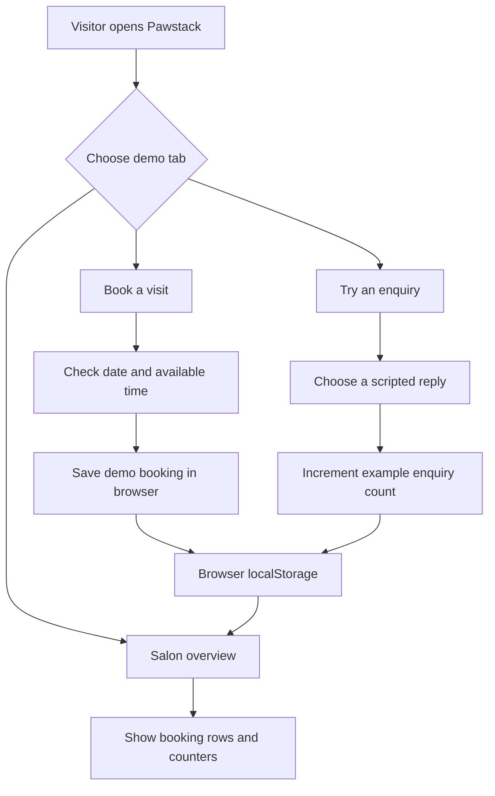

[README.md](https://github.com/user-attachments/files/33305988/README.md)
<div align="center">

# 🐾 Pawstack

### More bookings. Less busywork.

**A modern agency website and interactive product demo for pet-grooming businesses.**

Pawstack helps independent groomers imagine a better way to get discovered, turn customer enquiries into appointments, and run their day without being tied to the phone.

**[Explore the demo](#try-the-interactive-demo) · [Run locally](#quick-start) · [See the features](#features) · [Deployment](#deployment)**

**Responsive design** · **Vanilla HTML, CSS & JavaScript** · **No build step** · **No runtime dependencies**

> **Project status: Portfolio prototype.** The agency, showcased client businesses, example metrics, and service offers are illustrative. This repository is not a live booking or customer-messaging service.

</div>

---

## Preview

<table>
  <tr>
    <th>Desktop experience</th>
    <th>Mobile experience</th>
  </tr>
  <tr>
    <td valign="top"></td>
    <td valign="top"></td>
  </tr>
</table>

*Screenshots show the example website as delivered. All displayed client brands and business outcomes are fictional.*

## The idea

Most grooming business owners would rather spend their time caring for animals than answering the same messages, coordinating their calendars, or following up with customers.

Pawstack presents a focused solution for **dog groomers, mobile groomers, and pet salons**: attractive websites, easy appointment booking, helpful first responses to new enquiries, and a single place to follow daily activity.

The customer-facing message is simple:

- **Keep operating costs low.** Build around lightweight tools and affordable hosting, instead of an expensive collection of subscriptions.
- **Start without a large commitment.** Illustrate a useful, limited free starter system that could be kept long-term, with specific terms to be defined before any real offer.
- **Spend less time on administration.** Let customers discover services, choose appointment slots, and see what happens next.
- **Make it easier for interested customers to book.** Give new enquiries a quick, helpful response and a clear path to an appointment—even when the groomer is busy.

These are **product goals and proposed agency benefits**, not measured claims about a deployed customer system.

## Features

This website combines an agency landing page with a small browser-based salon demonstration.

| Area | What visitors can experience | Current implementation |
| --- | --- | --- |
| **Agency homepage** | Clear positioning, services, value propositions, and calls to action | Implemented |
| **Responsive navigation** | Desktop navigation and a collapsible mobile menu | Implemented |
| **Services** | Website design, bookings, enquiry handling, follow-ups, dashboard views, and tailoring | Marketing concepts |
| **Portfolio** | Three sample grooming-business projects | Fictional examples |
| **Costs & free starter offer** | Explanation of lean running costs and the proposed starter option | Concept copy; no commercial offering configured |
| **Appointment booking** | Choose service, date, and an available demo time | Working in one browser only |
| **Availability** | Prevent two demo bookings from taking the same date/time slot | Client-side checks only |
| **Customer enquiry demo** | Send a message and see a contextual example response | Scripted keyword-based replies |
| **Salon overview** | Review booking rows and changing counters | Computed from local demo data |
| **Demo reset** | Restore the original appointments and example counters | Implemented |
| **Contact enquiry** | Compose and copy an example business enquiry | Clipboard preview; not submitted |
| **Reminders** | Preview a reminders metric and learn about reminder workflows | Demonstration only; no reminders sent |

### Example portfolio projects

The **Our work** section contains three fictional case studies to demonstrate the agency's intended specialisation:

1. **Maple & Mutt** — salon website and booking experience.
2. **The Dapper Dog** — customer-facing calendar and appointment selection.
3. **Milo Grooming Club** — simple overview of bookings, customers, and follow-ups.

Replace these concepts with real, permission-approved case studies before presenting the site as an established client portfolio.

## Try the interactive demo

Navigate to **Try the demo** on the website. The demonstration has three tabs that work together:

### 1. Book a visit

1. Open **Book a visit**.
2. Enter a sample customer name and pet name.
3. Choose **Full Groom**, **Bath & Brush**, or **Nail Trim**.
4. Pick a date and an available time.
5. Select **Confirm demo booking**.
6. Open **Salon overview** to see the new appointment.

The system provides six example appointment times: `09:00`, `10:30`, `12:00`, `13:30`, `15:00`, and `16:30`. Once a time is booked for a particular date, it is disabled in that browser's demo.

### 2. Try an enquiry

Open **Try an enquiry**, then send a question such as:

- `How much does grooming cost?`
- `Are you open on Saturday?`
- `Can I book an appointment?`

The demo displays a prewritten response based on keywords in the message. The enquiry count increases, and the **Try booking** button switches to the booking tab.

> These replies are local scripted examples. They do not connect to WhatsApp, Instagram, email, a customer inbox, or an external conversation service.

### 3. Review the salon overview

Open **Salon overview** to view the example appointments and dashboard counters. **Reset demo data** restores the two seeded appointments and initial counters, and returns the example chat to its starting conversation.

**Important demo limitations:** Bookings are not sent to a salon, no customer receives a confirmation, and no payment or real reminder is processed. The reminder count is illustrative, not a live notification queue.

## Quick start

### Option A — Open directly

Download or clone the project and open `index.html` in a modern browser. You do not need to install packages, set up environment variables, or run a build.

### Option B — Serve locally (recommended)

From the project folder, start a lightweight HTTP server:

```bash
python -m http.server 8000
```

Then visit:

```text
http://localhost:8000
```

On Windows, if `python` is unavailable but the Python launcher is installed, use `py -m http.server 8000`.

A local server is preferable for consistent browser behavior, especially for clipboard features that may be restricted under `file://` URLs.

### Requirements

- A current desktop or mobile browser with JavaScript enabled.
- Python **only if** you choose the local-server option.
- No Node.js, framework installation, database, or API key required.

## Project structure

```text
pawstack/
├── index.html           # Landing page, styles, and interactive demo
├── README.md            # Project documentation
├── desktop-preview.png  # Full desktop screenshot
├── mobile-preview.png   # Full mobile screenshot
├── desktop-hero.png     # Desktop hero screenshot
└── mobile-hero.png      # Mobile hero screenshot
```

Everything the website needs to run is contained in **`index.html`**. Screenshots are for repository documentation and previews; the website does not request them at runtime.

## How it works

### Technology

| Layer | Technology | Purpose |
| --- | --- | --- |
| Markup | HTML5 | Semantic page structure, forms, navigation |
| Styling | CSS3 | Responsive layouts, components, transitions, custom properties |
| Interactions | Vanilla JavaScript | Booking flow, demo chat, dashboard, mobile menu |
| Demo persistence | `localStorage` | Retain bookings and enquiry count where browser storage is permitted |
| Deployment | Static hosting | Serve the HTML and other repository assets |

The site makes **no network requests to an application backend** and uses **no external JavaScript packages**. Its font stack uses `Inter` if installed, with system-font fallbacks; no web font is downloaded by the page.

### Demo data flow



The JavaScript is wrapped in an immediately invoked function expression to keep demo logic out of the global scope. Displayed booking values and chat messages are inserted as text, not parsed as user-supplied HTML.

### Browser storage

The demo uses these keys:

| Key | Contents |
| --- | --- |
| `pawstack-demo-bookings` | JSON array of example and user-added demo bookings |
| `pawstack-demo-enquiries` | Sample enquiry counter |

The initial state contains **two example bookings** and an enquiry count of **eight**. The sample chat resets on each new page load; only the booking data and enquiry count are persisted.

Storage is **local to the browser and origin**. It is not shared between devices, browsers, or visitors, and may be unavailable in private browsing or restricted storage modes. Use fictional names while testing; browser storage is not a secure database for live customer records.

## Customisation guide

Because the project is deliberately a single file, most updates can be made in `index.html` with a text editor such as VS Code.

### Change the brand

Search for `Pawstack`, `pawstack.`, and the hero headline **A fuller calendar. A quieter phone.** Update the `<title>`, meta description, header/footer, and text as needed.

### Update colours and typography

Edit the CSS variables in the `:root` block near the top of `index.html`:

```css
:root {
  --ink: #17392f;
  --paper: #fcfbf7;
  --lime: #c8ed8b;
  --coral: #f6b396;
}
```

The typography is defined on the `body` rule. The layout has responsive breakpoints at approximately **1000px**, **760px**, and **390px**, plus a reduced-motion media query.

### Replace demonstration projects

Find the `#work` section and replace the three example business names, descriptions, and preview artwork with real case studies. Do not publish invented customer testimonials or unverified performance claims as factual results.

### Adjust booking services and time slots

The service dropdown lives in `#booking-form`. Available demo times are set in the script:

```js
const times = ['09:00', '10:30', '12:00', '13:30', '15:00', '16:30'];
```

Initial demo appointments are configured in `initialBookings`. Changing the source data does **not** automatically overwrite demo data already saved in a visitor's browser; click **Reset demo data** or clear the site's browser storage to start fresh.

### Change example replies

Find the `#chat-form` submit handler in the script. It chooses responses with simple keyword checks (for example, pricing, opening hours, and appointments). These rules are best treated as examples of the desired customer journey, not as production customer-support automation.

### Update the contact experience

The `#contact-form` handler currently assembles the entered information into a text preview and attempts to copy it with `navigator.clipboard.writeText()`. If clipboard access fails, it offers a manual copy prompt. **No message is sent to the agency.** Integrate a backend or form service before inviting real enquiries.

## Deployment

Pawstack can be published on most static hosts because it requires no server-side runtime.

### GitHub Pages

1. Create a GitHub repository and add the files shown in [Project structure](#project-structure).
2. Commit and push the files, with `index.html` in the repository root.
3. Open **Settings → Pages** in the GitHub repository.
4. Under **Build and deployment**, select **Deploy from a branch**, then choose your publishing branch and **`/(root)`**.
5. Save the settings and use the Pages URL provided by GitHub after publishing finishes.

You can also deploy the same folder to other static hosting providers such as Netlify, Cloudflare Pages, or Vercel using their standard static-site workflows.

> **Publishing makes the prototype publicly viewable; it does not turn the demonstration into a real booking system.** GitHub Pages does not add a backend, shared database, or customer notifications.

## Quality and accessibility notes

The current prototype includes mobile layouts, labelled form inputs, keyboard-focus styles, some ARIA attributes, a polite status-message region, and reduced-motion styling. It has not been presented as having passed a formal WCAG accessibility audit.

Suggested manual smoke test:

| Test | Expected result |
| --- | --- |
| Resize to a narrow mobile viewport | Navigation collapses and content remains usable |
| Click each top navigation link | Page scrolls to the appropriate section |
| Submit booking without a time | A message asks for a slot |
| Book an available time | Booking appears in Salon overview |
| Try to use the same date/time again | That slot is disabled in this browser |
| Reload the page | Saved demo bookings and enquiry count are restored when storage works |
| Ask about price or booking | A relevant scripted response appears |
| Click Reset demo data | Seed appointments and counters return |
| Submit the contact form | A preview is copied or offered for manual copying; nothing is sent |
| Use the site with a keyboard | Visible focus indicators appear on supported controls |

For a future public launch, also test across browsers, verify contrast and keyboard navigation, assess screen-reader behavior, and test every server-side failure case introduced by real integrations.

## Prototype boundaries

This is a **showcase and local interaction prototype**, not a complete SaaS application. In particular:

- **No backend or shared database:** appointments exist only in the current browser's storage.
- **No real availability sync:** double-booking checks apply only to that local browser state, not multiple customers.
- **No actual messaging automation:** responses are prewritten and displayed on the page only.
- **No delivered reminders:** displayed reminder numbers are examples.
- **No live lead collection:** the contact form copies a text preview rather than submitting it.
- **No accounts, payments, or access control:** no authentication or checkout is implemented.
- **No proven outcomes:** fictional project brands and illustrative figures must not be represented as client evidence.

**Commercial note:** The near-zero-cost approach is an architectural goal, not a universal guarantee. Domain registration, paid message delivery, payment provider fees, hosting above free-tier limits, maintenance, and support can create ongoing costs. Likewise, the long-term free starter option is a proposed offering; its features, eligibility, and service terms still need to be specified.

## Roadmap

A practical sequence for turning this concept into a service for real grooming businesses:

- [x] Build the responsive agency landing page.
- [x] Add fictional case-study previews and a transparent prototype disclaimer.
- [x] Create a working browser-only booking flow.
- [x] Add scripted enquiry replies and a sample dashboard.
- [ ] Replace examples with authorised real work and verified results.
- [ ] Connect contact forms to a secure lead inbox or API.
- [ ] Add shared booking storage and server-side availability enforcement.
- [ ] Build salon-owner accounts, permissions, and business settings.
- [ ] Add calendar integration and automated appointment confirmations.
- [ ] Add opted-in reminders, follow-ups, and customer communication channels.
- [ ] Add reliable enquiry-to-booking workflows, human handoff, and conversation logging.
- [ ] Define the free starter plan and transparent pricing/maintenance terms.
- [ ] Add privacy documentation, retention controls, monitoring, and automated tests.

A backend (for example, FastAPI or Django) and a persistent database (for example, PostgreSQL) could support the production version; no backend technology has been selected or implemented in this prototype.

## Contributing and reuse

This project is currently a personal portfolio prototype. Suggestions and improvements can be proposed through repository issues or pull requests **if** the project is published on a platform where those features are enabled.

**License:** No `LICENSE` file has been provided with this prototype. Do not assume that its code or brand assets are offered under an open-source license; add an explicit license before advertising reusable licensing terms.

---

<div align="center">

**Pawstack — built around the grooming business, not the other way around.**

*More time with the pets. Fewer missed opportunities.*

</div>
